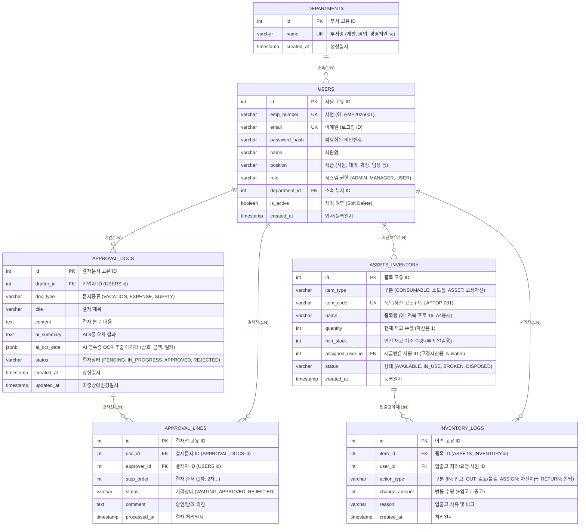

# 🗄️ 02. 데이터베이스 설계서 (ERD & Table Schema)

본 문서는 `inhouse-pm-system`의 핵심 데이터 모델과 테이블 간의 관계(ERD)를 정의합니다.

- **DBMS:** PostgreSQL 16+
- **ORM:** SQLAlchemy (Python)

---

## 1. 전체 ERD 다이어그램 (Mermaid)

_GitHub 마크다운 뷰어에서 테이블 간 관계도가 자동으로 시각화됩니다._

---

## 2. 테이블별 상세 명세

### ① `departments` (부서 테이블)

| 컬럼명       | 데이터 타입   | 제약조건           | 설명                            |
| :----------- | :------------ | :----------------- | :------------------------------ |
| `id`         | `SERIAL`      | `PRIMARY KEY`      | 부서 고유 번호                  |
| `name`       | `VARCHAR(50)` | `UNIQUE, NOT NULL` | 부서명 (예: 경영지원팀, 개발팀) |
| `created_at` | `TIMESTAMP`   | `DEFAULT NOW()`    | 생성 일시                       |

### ② `users` (사원 및 권한 테이블)

| 컬럼명          | 데이터 타입    | 제약조건                   | 설명                                     |
| :-------------- | :------------- | :------------------------- | :--------------------------------------- |
| `id`            | `SERIAL`       | `PRIMARY KEY`              | 사원 고유 번호                           |
| `emp_number`    | `VARCHAR(20)`  | `UNIQUE, NOT NULL`         | 사원번호 (예: `2026001`)                 |
| `email`         | `VARCHAR(100)` | `UNIQUE, NOT NULL`         | 로그인용 사내 이메일                     |
| `password_hash` | `VARCHAR(255)` | `NOT NULL`                 | Bcrypt 해시 비밀번호                     |
| `name`          | `VARCHAR(50)`  | `NOT NULL`                 | 사원 이름                                |
| `position`      | `VARCHAR(30)`  | `NOT NULL`                 | 직급 (사원, 대리, 팀장, 대표 등)         |
| `role`          | `VARCHAR(20)`  | `NOT NULL, DEFAULT 'USER'` | 권한 (`ADMIN`, `MANAGER`, `USER`)        |
| `department_id` | `INTEGER`      | `FK (departments.id)`      | 소속 부서 외래키                         |
| `is_active`     | `BOOLEAN`      | `DEFAULT TRUE`             | 재직 여부 (`False`면 퇴사자 로그인 차단) |
| `created_at`    | `TIMESTAMP`    | `DEFAULT NOW()`            | 등록 일시                                |

### ③ `approval_docs` (전자결재 문서 테이블)

| 컬럼명        | 데이터 타입    | 제약조건                  | 설명                                                    |
| :------------ | :------------- | :------------------------ | :------------------------------------------------------ |
| `id`          | `SERIAL`       | `PRIMARY KEY`             | 결재 문서 번호                                          |
| `drafter_id`  | `INTEGER`      | `FK (users.id), NOT NULL` | 기안자(작성자) ID                                       |
| `doc_type`    | `VARCHAR(30)`  | `NOT NULL`                | 양식 구분 (`VACATION`, `EXPENSE`, `SUPPLY`)             |
| `title`       | `VARCHAR(200)` | `NOT NULL`                | 결재 문서 제목                                          |
| `content`     | `TEXT`         | `NOT NULL`                | 결재 본문 (AI 초안 생성 지원)                           |
| `ai_summary`  | `TEXT`         | `NULLABLE`                | AI가 생성한 결재자용 3줄 핵심 요약                      |
| `ai_ocr_data` | `JSONB`        | `NULLABLE`                | 영수증 OCR 추출 JSON (`가맹점`, `금액`, `날짜`)         |
| `status`      | `VARCHAR(20)`  | `DEFAULT 'PENDING'`       | 상태 (`PENDING`, `IN_PROGRESS`, `APPROVED`, `REJECTED`) |
| `created_at`  | `TIMESTAMP`    | `DEFAULT NOW()`           | 상신 일시                                               |
| `updated_at`  | `TIMESTAMP`    | `DEFAULT NOW()`           | 최종 결재 상태 변경 일시                                |

### ④ `approval_lines` (결재선 테이블)

| 컬럼명         | 데이터 타입   | 제약조건                                   | 설명                                                 |
| :------------- | :------------ | :----------------------------------------- | :--------------------------------------------------- |
| `id`           | `SERIAL`      | `PRIMARY KEY`                              | 결재선 고유 번호                                     |
| `doc_id`       | `INTEGER`     | `FK (approval_docs.id), ON DELETE CASCADE` | 대상 결재 문서 ID                                    |
| `approver_id`  | `INTEGER`     | `FK (users.id), NOT NULL`                  | 결재권자(팀장/관리자) ID                             |
| `step_order`   | `INTEGER`     | `NOT NULL`                                 | 결재 순번 (1차 결재, 2차 결재...)                    |
| `status`       | `VARCHAR(20)` | `DEFAULT 'WAITING'`                        | 결재자 처리 상태 (`WAITING`, `APPROVED`, `REJECTED`) |
| `comment`      | `TEXT`        | `NULLABLE`                                 | 결재 의견 및 반려 사유                               |
| `processed_at` | `TIMESTAMP`   | `NULLABLE`                                 | 승인/반려 처리 시각                                  |

### ⑤ `assets_inventory` (재고 및 고정자산 통합 테이블)

| 컬럼명             | 데이터 타입    | 제약조건                  | 설명                                               |
| :----------------- | :------------- | :------------------------ | :------------------------------------------------- |
| `id`               | `SERIAL`       | `PRIMARY KEY`             | 품목 고유 번호                                     |
| `item_type`        | `VARCHAR(20)`  | `NOT NULL`                | 구분 (`CONSUMABLE`: 소모품, `ASSET`: 고정자산)     |
| `item_code`        | `VARCHAR(50)`  | `UNIQUE, NOT NULL`        | 관리 코드 / 시리얼 번호                            |
| `name`             | `VARCHAR(100)` | `NOT NULL`                | 품목명 (예: A4용지, ThinkPad X1)                   |
| `quantity`         | `INTEGER`      | `NOT NULL, DEFAULT 0`     | 현재 수량 (`CHECK (quantity >= 0)` 음수 방지)      |
| `min_stock`        | `INTEGER`      | `NOT NULL, DEFAULT 5`     | 안전 재고 기준치 (이하일 시 경고)                  |
| `assigned_user_id` | `INTEGER`      | `FK (users.id), NULLABLE` | 현재 자산 사용자 ID (고정자산 지급 시 기록)        |
| `status`           | `VARCHAR(20)`  | `DEFAULT 'AVAILABLE'`     | 상태 (`AVAILABLE`, `IN_USE`, `BROKEN`, `DISPOSED`) |
| `created_at`       | `TIMESTAMP`    | `DEFAULT NOW()`           | 등록 일시                                          |

### ⑥ `inventory_logs` (재고·자산 입출고 이력 테이블)

| 컬럼명          | 데이터 타입    | 제약조건                             | 설명                                        |
| :-------------- | :------------- | :----------------------------------- | :------------------------------------------ |
| `id`            | `SERIAL`       | `PRIMARY KEY`                        | 이력 고유 번호                              |
| `item_id`       | `INTEGER`      | `FK (assets_inventory.id), NOT NULL` | 대상 품목 ID                                |
| `user_id`       | `INTEGER`      | `FK (users.id), NOT NULL`            | 입출고 실행 또는 불출 요청 사원 ID          |
| `action_type`   | `VARCHAR(20)`  | `NOT NULL`                           | 작업 유형 (`IN`, `OUT`, `ASSIGN`, `RETURN`) |
| `change_amount` | `INTEGER`      | `NOT NULL`                           | 수량 변화량 (예: `+50`, `-2`)               |
| `reason`        | `VARCHAR(255)` | `NULLABLE`                           | 입출고 및 지급 사유                         |
| `created_at`    | `TIMESTAMP`    | `DEFAULT NOW()`                      | 이력 발생 일시                              |

---

## 3. 실무 설계 포인트 (포트폴리오 어필 요소)

1. **데이터 무결성 보장:** `assets_inventory.quantity`에 0 미만 방지 제약조건 및 트랜잭션 처리를 적용하여 동시 출고 시 마이너스 재고 발생을 원천 차단합니다.
2. **감사 추적(Audit Trail):** 재고 수량만 수정하는 것이 아니라 모든 변동을 `inventory_logs`에 기록하여 사내 자산 분실 및 오남용을 추적할 수 있습니다.
3. **PostgreSQL `JSONB` 활용:** 영수증 OCR 결과처럼 항목이 유동적일 수 있는 AI 추출 데이터는 PostgreSQL의 `JSONB` 컬럼에 저장하여 유연성과 검색 성능을 동시에 확보했습니다.
4. **Soft Delete 적용:** 퇴사한 사원을 `DELETE`로 지우면 과거 결재 문서와 자산 이력이 깨지므로, `users.is_active = False`로 비활성화하여 데이터 정합성을 유지합니다.
